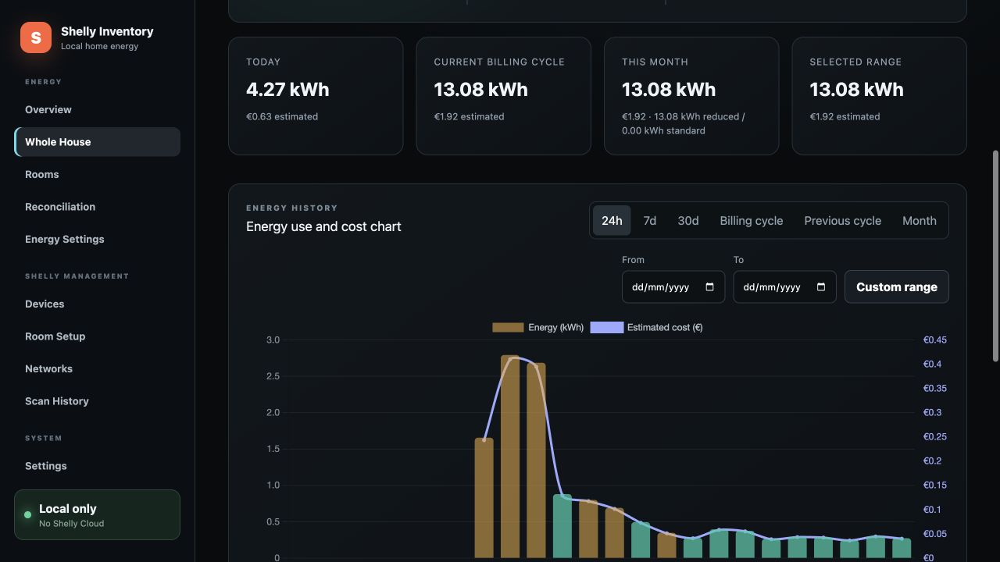
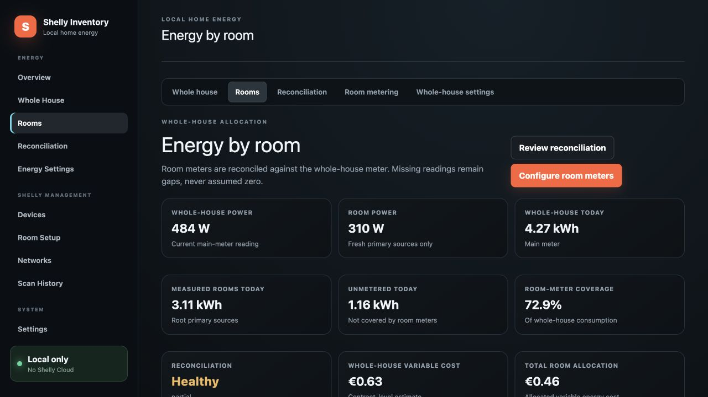
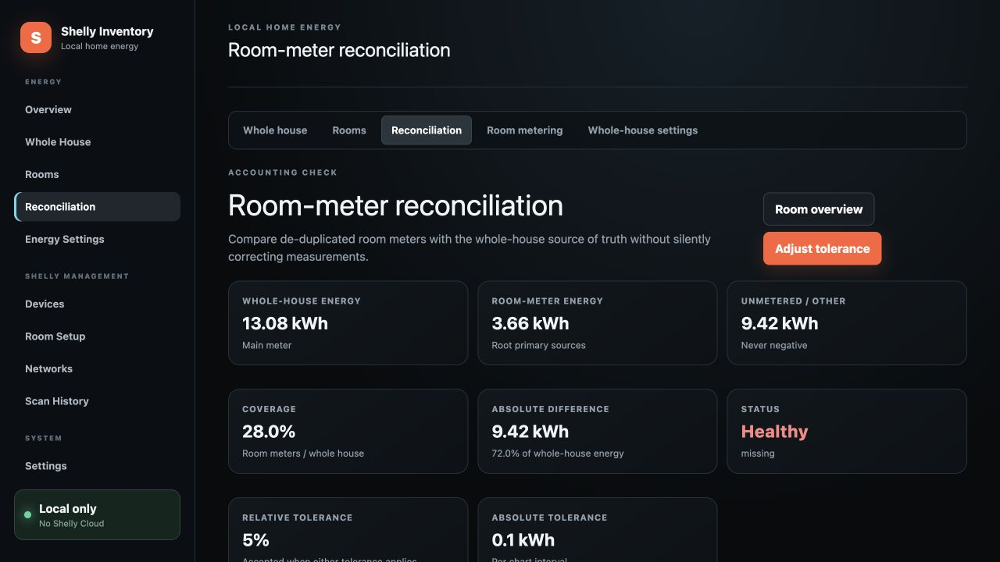

# Energy monitoring

Energy monitoring runs inside the server, independently of the web browser. It supports one whole-house source plus independently addressable room sources.

## Whole-house source

The main meter is one stable inventory device ID plus one validated component key. Supported sources include Gen1 `meter` and `emeter` data and Gen2-or-newer `switch`, `EM`, `EM1`, `PM`, and data companions.

Component keys map to fixed, allowlisted Shelly paths. Form input never selects an arbitrary URL or RPC method, and a meter must pass a live backend test before it can be saved.

| Device generation | Supported source families |
|---|---|
| Gen1 | `meter`, `emeter` |
| Gen2 and newer | `switch`, `EM`, `EM1`, `PM`, and their data companions |

Before each poll, the collector refreshes the device's current IP from stable inventory identity and reuses its encrypted credential profile. Requests use bounded retry backoff.

## Samples, counters, and retention

Cumulative imported-energy counters are preferred. When only power is available, the collector integrates consumption between samples. Long gaps are marked partial instead of inventing consumption. A counter decrease records a reset event and never produces negative energy. Export totals are retained when available but excluded from household-consumption cost.



_History ranges combine measured energy with the configured variable-cost estimate. The chart remains local to the application._

Default retention:

| Data | Retention |
|---|---:|
| Raw samples | 7 days |
| Minute aggregates | 90 days |
| Hourly aggregates | 730 days |
| Daily aggregates | Retained |

Cleanup never removes the current billing cycle. Disabling monitoring pauses collection without deleting settings or history. Changing the meter starts a new source series and does not merge counters.

## Pricing and billing

Pricing uses decimal arithmetic and versioned effective timestamps. Defaults target Portugal Continental and EUR:

- €0.137378/kWh before VAT
- 200 kWh per 30 days at the reduced VAT rate, or 300 kWh for large families
- 6% reduced and 23% standard VAT
- €0.001/kWh electricity excise tax, plus configured VAT

The allowance is prorated by exact billing-cycle length. Edit these defaults to match the current invoice before relying on an estimate.

While minute aggregates exist, a mid-hour or mid-day price change uses energy measured on each side of its effective minute. After minute detail expires, energy in a coarse bucket is allocated between price versions in proportion to elapsed time. Those results are explicitly marked as estimates because the original within-bucket load shape is no longer available.

Estimates include imported variable energy, VAT, and optional excise tax. They exclude contracted-power and other fixed invoice charges. Contracted kVA is retained for context but is not charged by the estimator.

## Room attribution

Inventory placement and energy assignment are intentionally separate:



_Room totals remain distinct from whole-house consumption, making unmetered energy and coverage explicit._

- An **inventory room** says where the physical Shelly device is installed.
- An **energy assignment** says which room a meter component measures.

This lets the four channels of a Shelly Pro 4PM measure four different rooms even though the device has one physical location. Moving a device's inventory room never rewrites energy history.

In **Energy → Room metering**, choose a discovered component, test it, select a room and role, then choose the effective time. The main whole-house component can be reused as a room source only after an explicit warning acknowledgement.

Assignments use half-open, effective-dated intervals. Moving a source closes its previous interval and starts a new one; earlier consumption stays with the old room. Presets cover now, the start of today, and the current billing cycle, with a validated custom local date and time. Future assignments can be removed. Deleting a room with history archives it and closes active assignments while preserving reports.

### Aggregation roles

| Role | Behavior |
|---|---|
| **Primary** | Contributes power and energy to a room total; a room can have multiple primaries |
| **Submeter** | Explains part of a named primary in the same room; never added again to the total |
| **Excluded** | Visible for diagnostics but excluded from totals, comparisons, reconciliation, and cost |

For example, a 10 kWh Kitchen primary with 3 kWh Dishwasher and 2 kWh Refrigerator submeters remains a 10 kWh room total. The remaining 5 kWh is shown as other usage on that circuit. If submeters exceed their parent, the dashboard reports an overlap warning without changing the measured room total.

Excluded sources are polled only when diagnostic collection is enabled.

## Reconciliation

The whole-house meter remains the source of truth. For each aligned interval:



_Reconciliation preserves measured differences and exposes the configured tolerances instead of silently changing assignments._

```text
room-metered energy = sum of root primary room sources
unmetered energy    = max(whole-house energy - room-metered energy, 0)
coverage            = room-metered energy / whole-house energy
```

**Unmetered / Other** is calculated, not an editable room. It represents unmetered circuits, measurement gaps, standby loads, and any other consumption present at the main meter.

Missing source data is never treated as zero. Intervals and cards are labelled complete, partial, stale, missing, estimated, or reconciliation warning as appropriate.

### Data-quality states

| State | Meaning |
|---|---|
| Complete | All expected sources supplied fresh data for the interval |
| Partial | Some usable data exists, but one or more expected observations is absent |
| Stale | The latest source value is older than twice its configured poll interval |
| Missing | No usable source data exists for the interval |
| Estimated | A coarse bucket required proportional time splitting after fine detail expired |
| Reconciliation warning | Room sources materially exceed the whole-house source |

The default over-measurement tolerance is 5% or 0.10 kWh per interval. A small mismatch preserves room measurements and proportionally normalizes allocation. A larger mismatch remains visible for investigation; unmetered consumption never becomes negative. Tolerances and diagnostic collection are configurable on the room-metering page.

## Allocated room cost

VAT and electricity pricing are calculated once for the whole contract, including the single prorated reduced-VAT allowance and excise tax. The resulting variable cost is allocated to rooms and Unmetered / Other by interval energy share.

When room totals exceed the main meter, shares are normalized against measured-room energy. A deterministic largest-remainder pass guarantees that room costs plus unmetered cost equal the whole-house estimate to the cent. Fixed invoice charges remain excluded.

After minute history expires, an assignment or price change inside a coarse hour/day bucket may require proportional time splitting. Those points are marked estimated.

---

[Documentation index](README.md) · [Getting started](getting-started.md) · [Troubleshooting](troubleshooting.md)
